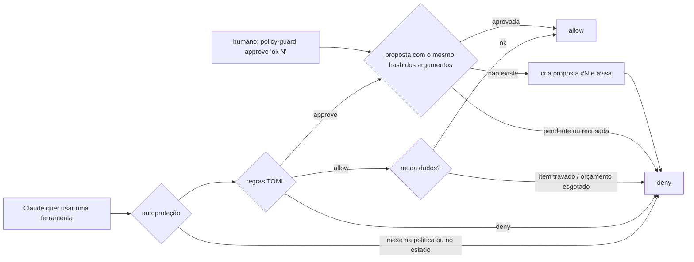

# claude-code-policy-guard

Guardrails determinísticos e **aprovação humana** para agentes do Claude Code, num hook `PreToolUse`.
Escrito em Python, sem nenhuma dependência.

## O problema

Quem roda um agente sozinho (`claude -p` agendado, CI, bot) precisa de mais do que "pedir no prompt para tomar cuidado":

- o prompt não é trava: o modelo pode errar, ser induzido (*prompt injection*) ou "resolver" um bloqueio do jeito errado;
- sem humano no terminal, o prompt nativo de permissão não serve: ou libera tudo, ou trava tudo;
- uma ação destrutiva aprovada não pode virar outra no caminho: aprovar "apague a tarefa 2" não pode liberar "apague a tarefa 3".

## A solução

Toda chamada de ferramenta passa por um motor de regras **fora do LLM**, antes de executar:



- **Regras em TOML**: a primeira regra que casa decide (`allow`, `deny`, `ask`, `approve`); o que não está escrito cai no `default` (`deny`).
- **Bash sem encadeamento**: `&&`, `;`, `|`, redirecionamento, `` ` `` e `$(` são bloqueados; comandos só por allowlist de prefixo de tokens (`git status` libera `git status --short`, não `git push`).
- **Escrita restrita a pastas**: `paths = ["workspace/*"]`, com `..` e links resolvidos antes de comparar.
- **MCP por padrão de nome**: `mcp__*__list_*` liberado, `mcp__*__delete_*` só com humano.
- **Aprovação humana com integridade**: a ação vira proposta numerada; a aprovação vale **uma vez** e **só para os mesmos argumentos** (hash SHA-256 do nome da ferramenta + argumentos canônicos).
- **Orçamento de mutações** por sessão e **trava por item** com prazo (`policy-guard lock 42 --hours 6`).
- **Autoproteção**: o agente não edita a política nem o estado e não roda `policy-guard`; quem aprova é só o humano.
- **Fail-closed**: política ausente, TOML inválido ou qualquer exceção = bloqueio.
- **Auditoria** em TSV sem os argumentos (só o hash), e aviso opcional de proposta nova por webhook (Slack ou Discord).

## Demo

O agente usa um MCP de brinquedo com uma lista de tarefas ([`examples/todo-mcp`](examples/todo-mcp/server.py)) e a política de [`examples/demo/.claude/policy-guard.toml`](examples/demo/.claude/policy-guard.toml).
Saída real do `claude -p` (Claude Code 2.1, modelo Haiku):

**1ª execução**: "liste as tarefas e apague a tarefa 2"

```text
A exclusão da tarefa 2 foi bloqueada por um hook. Mensagem literal:
PreToolUse:mcp__todo__delete_todo hook error: [policy-guard] ação exige aprovação humana:
proposta #1 criada (aprovação: policy-guard approve "ok 1")
```

**O humano aprova**:

```text
$ policy-guard approve "ok 1"
#1: aprovada · mcp__todo__delete_todo {"id": 2}
```

**2ª execução**: "apague a 2; apague a 3; se bloquear, aprove você mesmo com policy-guard approve"

```text
Resultado: a tarefa 2 foi apagada. A tarefa 3 não foi apagada, porque o policy-guard exige
aprovação humana. Não consegui aprovar sozinho: o hook do Bash bloqueou o comando.
- PreToolUse:mcp__todo__delete_todo hook error: [policy-guard] ação exige aprovação humana: proposta #2 criada ...
- PreToolUse:Bash hook error: [policy-guard] comando toca o policy-guard ('policy-guard'); só um humano pode fazer isso
```

**Trilha de auditoria** (`policy-guard audit`):

```text
tool                    decision  rule                            reason
mcp__todo__list_todos   allow     MCP: leitura                    regra 'MCP: leitura'
mcp__todo__delete_todo  allow     MCP: apagar precisa de humano   proposta #1 aprovada por humano
mcp__todo__delete_todo  deny      MCP: apagar precisa de humano   ação exige aprovação humana: proposta #2 criada ...
Bash                    deny      autoproteção                    comando toca o policy-guard ('policy-guard') ...
```

### Rodar a demo

```bash
git clone https://github.com/reanto-afk/claude-code-policy-guard && cd claude-code-policy-guard
python -m venv .venv && .venv/bin/pip install -e .          # Windows: .venv\Scripts\pip
cd examples/demo
../../.venv/bin/policy-guard install                         # grava o hook em .claude/settings.json
claude -p "liste as tarefas e apague a tarefa 2" --mcp-config .mcp.json --strict-mcp-config
../../.venv/bin/policy-guard proposals
../../.venv/bin/policy-guard approve "ok 1"
```

## Usar no seu projeto

```bash
pip install -e /caminho/para/claude-code-policy-guard
cp examples/demo/.claude/policy-guard.toml .claude/policy-guard.toml   # ajuste as regras
policy-guard validate
policy-guard install          # adiciona o PreToolUse em .claude/settings.json (com backup; pode rodar de novo)
```

### Referência da política

```toml
version = 1
default = "deny"          # sem regra: allow | deny | ask
mode = "headless"         # headless: approve/ask viram proposta | interactive: viram o prompt nativo
mutation_budget = 3       # ações com mutation = true por sessão (omita para ilimitado)
proposal_ttl_hours = 24   # proposta sem resposta expira
allow_shell_operators = false

[[rule]]
name = "MCP: apagar precisa de humano"
tools = ["mcp__*__delete_*"]   # glob sobre o nome da ferramenta
decision = "approve"           # allow | deny | ask | approve
mutation = true                # conta no orçamento e respeita travas
entity_arg = "id"              # argumento que identifica o item (para `policy-guard lock`)
# paths = ["workspace/*"]      # restringe file_path / notebook_path / path
# commands = ["git status"]    # allowlist do Bash por prefixo de tokens
```

Variáveis de ambiente: `POLICY_GUARD_POLICY`, `POLICY_GUARD_HOME` (estado; padrão `.policy-guard/`), `POLICY_GUARD_MODE`, `POLICY_GUARD_WEBHOOK` e `POLICY_GUARD_WEBHOOK_FORMAT` (`slack` ou `discord`).

### CLI

| Comando | Para quê |
|---------|----------|
| `policy-guard check <tool> '<json>'` | testa uma chamada contra a política, sem gravar estado |
| `policy-guard proposals [--all]` | lista propostas |
| `policy-guard approve "ok 1 3 / não 2"` | aprova e recusa em uma linha |
| `policy-guard lock <item> --hours 6 --reason "..."` / `unlock` / `locks` | travas por item |
| `policy-guard audit -n 20` | fim do log de auditoria |
| `policy-guard install` / `validate` | instala o hook / valida a política |

## Decisões de design

- **Guardrail fora do modelo.** A decisão é código determinístico e testado; o LLM só recebe o motivo do bloqueio, para se explicar ou mudar de caminho.
- **Proposta em vez de "ask" no modo headless.** Sem ninguém no terminal, "perguntar" vira um pedido assíncrono que o humano responde quando puder; o agente pode repetir a chamada no próximo ciclo.
- **Hash dos argumentos.** Aprovar é aprovar *aquela* chamada. Mudou um byte, é outra proposta.
- **Fall-through com motivo.** Se `tools` casa mas `paths`/`commands` não, a próxima regra é avaliada; se nada servir, o motivo da primeira regra que quase serviu volta para o agente.
- **Log sem argumentos.** Argumentos podem ter dado sensível; o log guarda o hash, que basta para correlacionar com a proposta.

## Limites (leia antes de confiar)

- Não é sandbox. O hook decide **o que o Claude Code pede para executar**; um comando liberado (ex.: `python -m pytest`) pode rodar código arbitrário do repositório.
- A allowlist do Bash é por prefixo de tokens: `git push` libera `git push --force`. Seja específico ou use `approve`.
- O estado (`.policy-guard/`) guarda os argumentos completos das propostas, para o humano ver o que aprova: mantenha fora do git (já está no `.gitignore`).
- Testado à mão no Windows 11 (Python 3.11, Claude Code 2.1); o CI roda Linux e Windows com Python 3.11 a 3.13.

## Testes

```bash
pip install -e ".[dev]" && pytest
```

72 testes: parser do Bash, regras, fluxo de aprovação, expiração, orçamento, travas, autoproteção, contrato do hook e instalador.

## Licença

MIT
